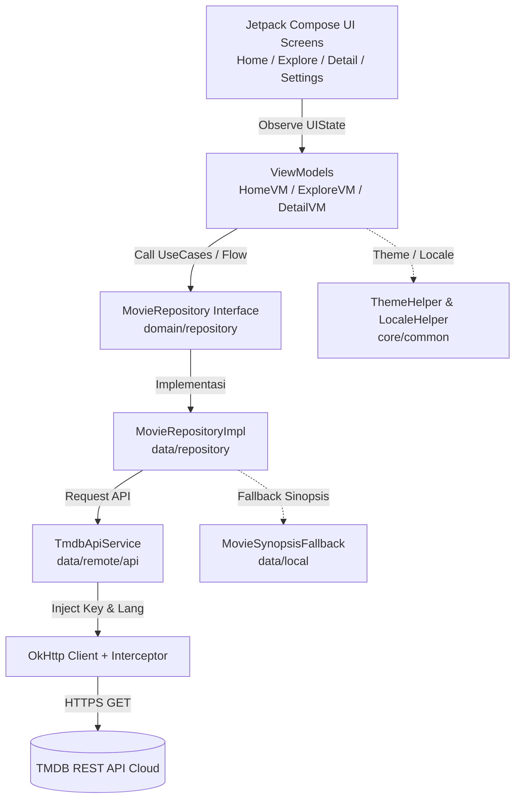
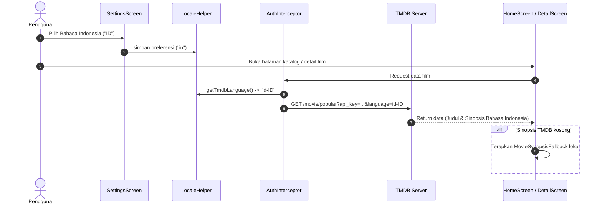

# 🎬 Xinema — Modern Cinema & TV Series Catalog App

<div align="center">


<br />
**Aplikasi Eksplorasi & Katalog Film serta Serial TV Modern Berbasis Android Jetpack Compose**
<br />
*"Temukan Film & Serial Favoritmu dalam Satu Genggaman dengan Tampilan Sinematik Cepat & Responsif."*

[](https://developer.android.com/)
[](https://kotlinlang.org/)
[](https://developer.android.com/jetpack/compose)
[](https://m3.material.io/)
[](https://square.github.io/retrofit/)
[](https://www.themoviedb.org/)
[](#-arsitektur-dan-alur-data)
[](https://github.com/Byatarade)

</div>

---

## 📋 Daftar Isi

- [📖 Pengertian Aplikasi](#-pengertian-aplikasi)
- [📸 Galeri Antarmuka (Screenshots)](#-galeri-antarmuka-screenshots)
  - [Splash Screen & Cold-Start](#1-splash-screen--animasi-cold-start)
  - [Mode Potret (Portrait Display)](#2-tampilan-mode-potret-portrait)
  - [Mode Lanskap & Responsif (Landscape Adaptive Layout)](#3-tampilan-mode-lanskap-adaptive-navigation-rail)
- [🎯 Prinsip Produk & Solusi Masalah](#-prinsip-produk--solusi-masalah)
- [🛠️ Tech Stack & Ekosistem](#️-tech-stack--ekosistem)
- [✨ 10 Fitur & Keunggulan Utama](#-10-fitur--keunggulan-utama-xinema)
- [🏗️ Arsitektur dan Alur Data](#️-arsitektur-dan-alur-data)
  - [Diagram Arsitektur Clean Architecture + MVVM](#diagram-arsitektur)
  - [Alur Multi-Bahasa Dinamis (Bilingual TMDB Injection)](#alur-injeksi-multi-bahasa-tmdb)
- [📂 Struktur Direktori Proyek](#-struktur-direktori-proyek)
- [🚀 Cara Menjalankan Aplikasi (Setup & Build)](#-cara-menjalankan-aplikasi-setup--build)
- [🎨 Filosofi Desain: "Cinematic Dark & Crisp Light"](#-filosofi-desain-cinematic-dark--crisp-light)
- [👨‍💻 Pembuat (Author)](#-pembuat-author)
- [📄 Lisensi](#-lisensi)

---

## 📖 Pengertian Aplikasi

**Xinema** adalah aplikasi Android modern berbasis **Jetpack Compose** untuk menjelajahi, mencari, dan mengelola katalog film bioskop serta serial televisi dari seluruh dunia menggunakan data resmi **The Movie Database (TMDB) API**.

Aplikasi ini dirancang dengan standar industri perangkat lunak modern:
- Mengimplementasikan **Clean Architecture (Data, Domain, Presentation/UI)** dan **StateFlow/MVVM**.
- Sepenuhnya dibangun secara deklaratif menggunakan **100% Jetpack Compose** tanpa XML view konvensional.
- Dilengkapi **animasi cold-start tanpa blank screen** (teroptimasi khusus untuk perangkat Android seperti Vivo Y21s).
- Mendukung adaptasi tata letak responsif dua arah (**Portrait** dan **Landscape**) dengan *Adaptive Navigation Rail*.
- Menyediakan personalisasi tema mandiri (**Mode Malam / Night** dan **Mode Terang / Not Night**) serta **Multi-Bahasa (Bahasa Indonesia & English)** dengan fallback otomatis.

---

## 📸 Galeri Antarmuka (Screenshots)

Berikut adalah dokumentasi tampilan antarmuka riil aplikasi **Xinema**:

### 1. Splash Screen & Animasi Cold-Start

<div align="center">
  
  <p><em>Splash Screen Sinematik dengan Logo Vektor "X" Merah Glossy, Pulsing Halo Glow, dan Tipografi Modern</em></p>
</div>

---

### 2. Tampilan Mode Potret (Portrait)

<div align="center">
  <table>
    <tr>
      <td align="center" width="33%">
        <br />
        <b>Beranda (Home)</b><br />
        <em>Hero Banner sinematik, kategori Trending, Series, dan Korean Drama</em>
      </td>
      <td align="center" width="33%">
        <br />
        <b>Jelajahi & Cari (Search)</b><br />
        <em>Pencarian instan, filter genre, dan grid kartu film responsif</em>
      </td>
      <td align="center" width="33%">
        <br />
        <b>Detail Film (Detail View)</b><br />
        <em>Backdrop poster, tombol trailer, jajaran aktor utama, dan daftar film serupa</em>
      </td>
    </tr>
    <tr>
      <td align="center" colspan="3">
        <br />
        <br />
        <b>Pengaturan Aplikasi (Settings)</b><br />
        <em>Ganti Bahasa (ID / EN) & Mode Tema (Malam / Bukan Malam / Sistem)</em>
      </td>
    </tr>
  </table>
</div>

---

### 3. Tampilan Mode Lanskap (Adaptive Navigation Rail)

Saat orientasi layar diputar menjadi **Lanskap (Landscape)**, antarmuka otomatis menyesuaikan agar tidak sempit: *Bottom Navigation Bar* bertransformasi menjadi **Navigation Rail** di sisi kiri, dan poster film ditampilkan dalam grid adaptif multi-kolom yang luas.

<div align="center">
  <table>
    <tr>
      <td align="center" width="50%">
        <br />
        <b>Beranda Mode Lanskap</b>
      </td>
      <td align="center" width="50%">
        <br />
        <b>Pencarian & Eksplorasi Mode Lanskap</b>
      </td>
    </tr>
    <tr>
      <td align="center" colspan="2">
        <br />
        <br />
        <b>Detail Film Mode Lanskap (Tata Letak Split Banner & Info)</b>
      </td>
    </tr>
  </table>
</div>

---

## 🎯 Prinsip Produk & Solusi Masalah

### Kendala Aplikasi Katalog Film Konvensional:
1. **Layar Berkedip (Blank Black / White Flash) Saat Buka Aplikasi:** Banyak aplikasi mengalami *double splash* atau layar hitam sesaat sebelum Compose selesai dimuat di perangkat seperti Vivo/Funtouch OS.
2. **Keterbatasan Bahasa TMDB:** Endpoint TMDB API sering kali tidak memiliki sinopsis dalam Bahasa Indonesia (menghasilkan deskripsi kosong).
3. **Pencarian 404 & Salah Tipe Media:** Percampuran antara `movie` dan `tv` sering menyebabkan *crash* 404 saat memanggil endpoint `/movie/{id}` untuk konten serial TV.
4. **Tampilan Sempit di Mode Lanskap:** Tata letak ponsel yang kaku sering membuat aplikasi tidak nyaman digunakan saat menonton atau memutar ponsel.
5. **Kontras Status Bar Rusak Saat Ganti Tema:** Ikon jam, baterai, dan sinyal sering hilang/tenggelam karena warna *system bars* tidak sinkron secara reaktif.

### Solusi Fondasi di Xinema:
* 🚀 **Zero-Flash Cold Start (Single Activity):** Mengintegrasikan `Theme.Jetpack.Starting` di level window OS dengan `@drawable/splash_background` sehingga logo langsung tampil di milidetik ke-0 tanpa blank screen.
* 🌐 **Smart Bilingual Engine & TMDB Interceptor:** Menyisipkan parameter bahasa secara dinamis (`id-ID` atau `en-US`) melalui OkHttp Interceptor, dilengkapi kamus fallback sinopsis lokal.
* 🛡️ **Type-Safe Routing Media (`movie` vs `tv`):** Navigasi membawa parameter eksplisit `mediaType` untuk memanggil endpoint detail yang akurat (`/movie/{id}` atau `/tv/{id}`) dan memfilter hasil bertipe `person`.
* 📱 **Adaptive Edge-to-Edge Navigation:** Menu bawah otomatis berpindah menjadi *Navigation Rail* saat orientasi lanskap aktif dengan `tonalElevation = 0.dp` dan penanda aktif (*active pill*).
* 🌓 **Reaktif System Bars:** Menggunakan `WindowCompat.getInsetsController` untuk menjaga kontras ikon status bar (hitam di tema terang, putih di tema gelap).

---

## 🛠️ Tech Stack & Ekosistem

Aplikasi ini dibangun menggunakan arsitektur modern berbasis Android Jetpack dan ekosistem Google:

| Komponen | Teknologi | Keterangan & Peran |
|---|---|---|
| **Language** | **Kotlin 2.2.10** | Bahasa pemrograman utama dengan coroutines dan flow asinkron. |
| **UI Toolkit** | **Jetpack Compose (BOM 2024.11.00)** | UI toolkit deklaratif modern untuk membangun seluruh tampilan. |
| **Design System** | **Material 3 (M3)** | Komponen Material Design 3, color scheme, typography, dan card elevation. |
| **Architecture** | **Clean Architecture + MVVM** | Pemisahan Presentation, Domain, Data, dan Core layer. |
| **Networking** | **Retrofit 2.11.0 + OkHttp 4.12.0** | REST client, Gson converter, logging, dan Auth/Language Interceptors. |
| **Image Loading** | **Coil Compose 2.7.0** | Pemuatan poster dan backdrop TMDB secara asinkron dengan caching. |
| **Navigation** | **Navigation Compose 2.8.5** | Routing antar-layar berbasis grafik rute (`Screen.kt`). |
| **State Management** | **StateFlow & ViewModel** | Pengelolaan state UI yang tahan terhadap perubahan konfigurasi/rotasi. |
| **Local Storage** | **SharedPreferences** | Persistensi setelan tema dan preferensi bahasa pengguna. |
| **Build System** | **Gradle Kotlin DSL (AGP 9.5.1)** | Manajemen dependensi versi katalog (`libs.versions.toml`). |

---

## ✨ 10 Fitur & Keunggulan Utama Xinema

### 1. 🎬 Katalog Film & Serial TV Lengkap (*Powered by TMDB*)
Menampilkan kurasi film teranyar yang sedang tayang di bioskop (*Now Playing*), film populer (*Popular*), konten tren (*Trending Today*), serial drama Korea (*Korean TV Drama*), hingga serial televisi pilihan.

### 2. ⚡ Zero-Flash Instant Splash Screen (Ramah Vivo Y21s & Android 11+)
Tidak menggunakan Activity kedua yang memicu *double splash*. Aplikasi menggunakan *Single Activity Architecture* dengan tema cold-start bawaan OS yang langsung menyambung ke animasi Compose dengan kurva *scale bounce*, *pulsing glow*, dan tipografi sinematik.

### 3. 🌐 Dukungan Multi-Bahasa Dinamis (Bilingual: ID & EN)
Pengguna dapat berganti antara **Bahasa Indonesia** dan **English** secara instan di menu Pengaturan. Aplikasi secara dinamis meminta sinopsis bahasa terkait ke server TMDB dan menyajikan fallback deskripsi lokal jika TMDB belum memiliki terjemahannya.

### 4. 🌗 Mode Tema Adaptif (Night & Not Night)
Tersedia 3 opsi tema: **Ikuti Sistem (System Default)**, **Not Night (Mode Terang)**, dan **Night (Mode Gelap)**. Seluruh palet warna, menu bar, teks, hingga kartu poster berganti seketika dengan kontras yang terjamin.

### 5. 🔄 Navigasi Lanskap Cerdas (*Adaptive Navigation Rail*)
Saat layar diputar horizontal, menu bar bawah otomatis berpindah ke sisi samping kiri sebagai *Navigation Rail*, menjaga ruang vertikal tetap leluasa untuk eksplorasi poster tanpa terpotong.

### 6. 🔍 Pencarian Real-Time & Filter Genre
Fitur pencarian instan dengan *debounce* untuk menemukan film atau serial TV berdasarkan judul, dilengkapi *chips* filter genre untuk eksplorasi cepat.

### 7. 🃏 Komponen ElevatedCard Standar Industri
Poster dibungkus menggunakan komponen resmi Material 3 `ElevatedCard` dan `Card` yang memenuhi standar penilaian proyek mobile dengan elevasi sentuhan dan *rounded corner* halus.

### 8. 🎥 Pratinjau Trailer & Cuplikan YouTube
Integrasi pemutaran trailer resmi film langsung melalui YouTube intent atau web browser bawaan hanya dengan sekali sentuh pada bagian *Trailers & Teasers*.

### 9. 🌟 Rincian Top Cast & Film Serupa (*More Like This*)
Informasi mendalam mengenai pemeran utama (*Top Cast*) lengkap dengan foto profil aktor dan karakter, serta rekomendasi film serupa yang sejajar rapi (*pixel-perfect alignment*).

### 10. 🔋 Indikator Status Bar Reaktif
Sistem *insets* cerdas yang memastikan status bar (jam, baterai, sinyal) selalu kontras dan terbaca jelas di segala kondisi layar, termasuk saat melihat poster film gelap di mode terang.

---

## 🏗️ Arsitektur dan Alur Data

### Diagram Arsitektur



### Alur Injeksi Multi-Bahasa TMDB



---

## 📂 Struktur Direktori Proyek

Proyek ini menerapkan struktur paket bersih berbasis fitur dan tanggung jawab lapisan (*Clean Layered Architecture*):

```text
app/src/main/
├── AndroidManifest.xml                  # Konfigurasi aplikasi & starting theme
├── java/com/example/jetpack/
│   ├── CineStreamApp.kt                 # Application class & inisialisasi AppContainer
│   ├── MainActivity.kt                  # Single Activity, theme switcher, & splash orchestrator
│   │
│   ├── core/                            # Komponen inti & utilitas global
│   │   └── common/
│   │       ├── Constants.kt             # Konstanta base URL, image URL TMDB
│   │       ├── LocaleHelper.kt          # Pengelolaan bahasa aplikasi & inject TMDB
│   │       └── ThemeHelper.kt           # Logika tema (System, Light, Dark)
│   │
│   ├── data/                            # Lapisan Data (Remote & Repository)
│   │   ├── local/
│   │   │   └── MovieSynopsisFallback.kt # Fallback sinopsis lokal jika TMDB kosong
│   │   ├── remote/
│   │   │   ├── api/
│   │   │   │   ├── AuthInterceptor.kt   # Interceptor API Key & dinamis language header
│   │   │   │   └── TmdbApiService.kt    # Endpoint Retrofit (Movie & TV endpoints)
│   │   │   └── dto/                     # Data Transfer Objects (TMDB JSON response)
│   │   └── repository/
│   │       └── MovieRepositoryImpl.kt   # Implementasi MovieRepository
│   │
│   ├── di/                              # Dependency Injection manual
│   │   └── AppContainer.kt              # Service locator container untuk Retrofit & Repositories
│   │
│   ├── domain/                          # Lapisan Domain (Model & Kontrak Bisnis)
│   │   ├── model/
│   │   │   └── Movie.kt                 # Entitas domain Movie, MovieDetail, Cast, Video
│   │   └── repository/
│   │       └── MovieRepository.kt       # Interface kontrak repository
│   │
│   └── ui/                              # Lapisan Presentasi (Jetpack Compose)
│       ├── components/
│       │   └── CommonComponents.kt      # HeroBanner, MoviePosterCard, SectionRow, Loading, Error
│       ├── navigation/
│       │   ├── AppNavHost.kt            # NavHost, Scaffold, NavigationBar & NavigationRail
│       │   └── Screen.kt                # Definisi rute navigasi dan ikon menu
│       ├── screens/
│       │   ├── detail/                  # Layar Detail Film / Serial TV & ViewModel
│       │   ├── explore/                 # Layar Eksplorasi Genre, Search Bar, & ViewModel
│       │   ├── home/                    # Layar Beranda Utama (Hero & Carousel) & ViewModel
│       │   ├── search/                  # Layar Hasil Pencarian Mandiri
│       │   ├── settings/                # Layar Pengaturan Bahasa & Tema
│       │   └── splash/                  # Layar Splash Screen beranimasi sinematik
│       └── theme/
│           ├── Color.kt                 # Definisi warna semantik (NetflixRed, DarkSurface, dll.)
│           ├── Theme.kt                 # JetpackTheme dengan WindowInsetsControllerCompat reaktif
│           └── Type.kt                  # Tipografi Material 3
│
└── res/                                 # Sumber Daya Android
    ├── drawable/
    │   ├── ic_xinema_logo.xml           # Vektor resmi logo "X" merah glossy Xinema
    │   ├── ic_launcher_background.xml   # Background hitam launcher icon
    │   ├── ic_launcher_foreground.xml   # Foreground vektor launcher icon aman squircle
    │   └── splash_background.xml        # Background OS cold-start splash anti blank
    ├── values/
    │   ├── colors.xml                   # Palet warna XML
    │   ├── strings.xml                  # String resource bahasa Inggris (Default)
    │   └── themes.xml                   # Theme.Jetpack & Theme.Jetpack.Starting
    └── values-in/
        └── strings.xml                  # String resource terjemahan Bahasa Indonesia
```

---

## 🚀 Cara Menjalankan Aplikasi (Setup & Build)

Ikuti langkah-langkah di bawah ini untuk mengklon dan menjalankan proyek di Android Studio atau perangkat fisik:

### 1. Prasyarat Sistem
- **Android Studio**: Ladybug / Hedgehog / Jellyfish atau versi yang lebih baru.
- **JDK**: Java 11 atau Java 17.
- **Android SDK**: Min SDK 24 (Android 7.0 Nougat), Target SDK 35/37.
- **Perangkat**: Ponsel Android fisik (disarankan) atau Emulator Android.
- **API Key TMDB**: Dapatkan API Key gratis di [The Movie Database (TMDB)](https://www.themoviedb.org/documentation/api).

### 2. Kloning Repository
Buka terminal dan jalankan:
```bash
git clone https://github.com/Byatarade/Xinema.git xinema
cd xinema
```

### 3. Konfigurasi TMDB API Key
Buka berkas `local.properties` pada root proyek (buat berkas baru jika belum ada):
```properties
sdk.dir=/path/ke/Android/Sdk
TMDB_API_KEY=masukkan_api_key_tmdb_anda_disini
TMDB_READ_ACCESS_TOKEN=masukkan_read_access_token_opsional
```
*Variabel ini otomatis dibaca oleh `app/build.gradle.kts` ke dalam `BuildConfig.TMDB_API_KEY` saat proses build.*

### 4. Kompilasi & Build APK Debug
Jalankan perintah Gradle wrapper dari terminal:
```bash
./gradlew assembleDebug
```
Berkas APK hasil build akan berlokasi di:
```text
app/build/outputs/apk/debug/app-debug.apk
```

### 5. Install Langsung ke Ponsel via ADB
Pastikan USB Debugging aktif di ponsel Anda, lalu jalankan:
```bash
adb install -r app/build/outputs/apk/debug/app-debug.apk
```
Atau cukup buka folder proyek di **Android Studio** dan klik tombol **Run 'app' (Shift + F10)**.

---

## 🎨 Filosofi Desain: "Cinematic Dark & Crisp Light"

Desain antarmuka **Xinema** mengusung estetika bioskop kelas atas yang menggabungkan keanggunan platform streaming modern:

- 🔴 **Xinema Crimson Red (`#E50914`):** Warna primer penanda aksi utama, tombol play sinematik, dan penanda tab aktif.
- 🖤 **Pitch Black (`#000000` / `#0F0F0F`):** Latar belakang hitam murni pada mode malam yang menghemat daya layar AMOLED dan memberikan kontras tajam pada poster film.
- 🤍 **Crisp Clean White (`#F7F8FA` / `#FFFFFF`):** Latar belakang mode terang yang bersih, sejuk, dan tidak menyilaukan mata saat siang hari.
- 🎴 **Rounded Surface Cards (`16.dp`):** Kartu poster berlekuk modern dengan bayangan halus (*subtle elevation*) yang ramah sentuhan.
- 📱 **Zero Gimmick Edge-to-Edge:** Pemanfaatan layar penuh hingga ke bawah bilah navigasi gesture untuk pengalaman menonton yang imersif.

---

## 👨‍💻 Pembuat (Author)

Proyek ini dirancang, diarsitekruri, dan dibangun oleh:

<div align="center">

### **Byatarade**
*Android & Mobile Software Developer*

[](https://github.com/Byatarade)
[](https://github.com/Byatarade/Xinema)

*"Dibuat sebagai implementasi komprehensif teknologi Jetpack Compose, Clean Architecture, dan Material Design 3 di platform Android."*

</div>

---

<div align="center">
  <sub>Xinema © 2026. Data didukung oleh The Movie Database (TMDB) API.</sub>
</div>
